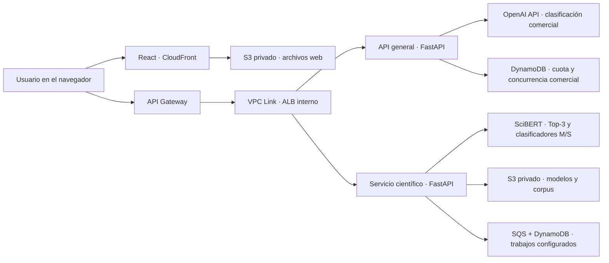

# Análisis y recomendación local de citas académicas

Aplicación académica que ayuda a explorar cómo se utiliza una referencia dentro de un artículo científico. A partir de un contexto de cita en inglés y un artículo citado, recupera tres fragmentos relacionados y predice la función de la cita en nueve categorías.

El proyecto del Grupo 19 de la Maestría en Inteligencia Artificial de la Universidad de los Andes reúne una **aplicación web**, sus servicios de inferencia y los experimentos que sustentan su desarrollo. También conserva el microproyecto inicial de recomendación de artículos con TF-IDF y un reordenador supervisado.

**[Aplicación web](https://proyectocitas-grupo19.click)** · **[Descargar modelos](https://proyectocitas-grupo19.click/models/)** · **[API](https://api.proyectocitas-grupo19.click)** · **[Estado científico](https://api.proyectocitas-grupo19.click/api/analisis-cita-ms/estado)** · **[Ayuda e incidencias](https://github.com/Byron971/microproyecto-local-citation/issues)**

## Contenido

- [Qué permite hacer](#qué-permite-hacer)
- [Acceso para la evaluación](#acceso-para-la-evaluación)
- [Estado y alcance](#estado-y-alcance)
- [Arquitectura](#arquitectura)
- [Ejecución local](#ejecución-local)
- [Uso de la API](#uso-de-la-api)
- [Configuración](#configuración)
- [Pruebas y validación](#pruebas-y-validación)
- [Despliegue en AWS](#despliegue-en-aws)
- [Datos y modelos](#datos-y-modelos)
- [Investigación y resultados](#investigación-y-resultados)
- [Organización del repositorio](#organización-del-repositorio)
- [Documentación y colaboración](#documentación-y-colaboración)

## Qué permite hacer

1. Introducir un párrafo en inglés y señalar una cita con una única marca `TARGETCIT`, o cargar un ejemplo de la interfaz.
2. Buscar el artículo citado por título o identificador y revisar las sugerencias semánticas de SciBERT antes de confirmarlo.
3. Elegir el clasificador M, S o el comercial, cuando esté habilitado.
4. Consultar los tres fragmentos recuperados, sus secciones y las puntuaciones de función de cita.

Las funciones son: **Background**, **Gap**, **Basis**, **Comparison**, **Application**, **Improvement / Modification**, **Evidence**, **Identification of the Originator** y **Further Reading**.

La modalidad comercial solicita consentimiento antes de enviar a OpenAI el contexto, el título y el resumen del artículo. Los fragmentos se muestran como apoyo a la lectura. Las puntuaciones de los modelos no son porcentajes de acierto ni probabilidades calibradas.

## Acceso para la evaluación

| Dato | Información |
| --- | --- |
| Proyecto | Análisis y recomendación local de citas académicas — Grupo 19. |
| Repositorio | [Byron971/microproyecto-local-citation](https://github.com/Byron971/microproyecto-local-citation). |
| Aplicación | [proyectocitas-grupo19.click](https://proyectocitas-grupo19.click). |
| API y clasificadores disponibles | [API](https://api.proyectocitas-grupo19.click) y [catálogo de clasificadores](https://api.proyectocitas-grupo19.click/api/clasificadores). |
| Integrantes | Carlos Eduardo Duque Lugo; John Byron Arias Sanz; Gabriel Gustavo Pinzón Páez; José María Zambrana Arze; Carlos Alfredo Caicedo Bermúdez. |

La interfaz no solicita una cuenta ni credenciales AWS al usuario. El clasificador comercial requiere consentimiento y está sujeto a la cuota compartida del servicio; las credenciales del proveedor permanecen en el backend. Para probar el flujo sin consumir esa cuota, elegir M o S.

**Recorrido de comprobación:** abrir la web, cargar un ejemplo, confirmar un artículo con texto disponible, elegir M o S y ejecutar el análisis. Se esperan tres fragmentos del artículo confirmado y nueve puntuaciones para el clasificador elegido. Revisar también el mensaje de un artículo sin texto preparado y la guía de funciones de la interfaz. El estado HTTP por sí solo no comprueba este recorrido.

El documento «07 Entregable y criterios de evaluación» exige además un **Word o PDF breve** con nombre del proyecto, integrantes y enlaces al repositorio y a la aplicación. Este README aporta esos datos, pero no sustituye ese entregable. Antes de la franja acordada de evaluación se debe confirmar el acceso al repositorio, mantener los servicios disponibles y repetir el recorrido funcional; si se restringe el acceso, proporcionar al evaluador las instrucciones por el canal de entrega.

## Estado y alcance

Descripción contrastada con el código y los manifiestos del repositorio al **23 de noviembre de 2026**. La disponibilidad de una instalación concreta se consulta en sus endpoints de estado y catálogo.

| Componente | Estado y alcance |
| --- | --- |
| Interfaz React | Recorrido integrado: contexto → artículo → clasificador → resultados; escritorio y móvil. |
| Búsqueda de artículos | Sugerencias SciBERT por título y resumen sobre un catálogo de 19.776 artículos. Es una tarea diferente de recuperar fragmentos. |
| Recuperación de fragmentos | Top-3 con SciBERT dentro del artículo confirmado, cuando dispone de texto preparado. |
| Clasificación M/S | Dos clasificadores basados en SciBERT, con pesos y manifiestos propios; separados del experimento factorial A4. |
| Clasificación comercial | GPT-6.1 Sol con definiciones de categorías, consentimiento, cuota diaria y control de concurrencia; aparece solo si está configurado y visible. |
| Trabajos de análisis | Contrato asíncrono con idempotencia, consulta y cancelación de trabajos en espera. Admite DynamoDB/SQS y un backend en memoria para desarrollo. |
| Modelo abierto / QLoRA en la web | Suspendido y oculto; su uso experimental para generar etiquetas no implica disponibilidad en la interfaz. |
| Funciones del microproyecto inicial | Se conservan TF-IDF + reordenador lineal, Top-3 BM25, tablero histórico y sus experimentos. No describen por sí solos el flujo web actual. |

El manifiesto del corpus ampliado declara **19.243 artículos preparados**, de los cuales **508** se recortaron a los límites de entrada. Los otros **533** artículos del catálogo no tienen contenido suficiente en ese snapshot. El corpus pequeño incluido en Git sirve para desarrollo; no equivale a toda esa colección.

El proyecto sigue siendo un prototipo académico. La cobertura del corpus, las clases escasas, la procedencia de las etiquetas y la validación humana incompleta limitan la interpretación de sus predicciones. La disponibilidad técnica del servicio no certifica su calidad científica.

## Arquitectura



Los dos servicios Python se ejecutan en contenedores Docker sobre **ECS Fargate**; React se distribuye como archivos estáticos desde **S3 y CloudFront**. **ECR** almacena imágenes, **SSM Parameter Store** gestiona referencias y credenciales, **CloudWatch** reúne registros y métricas, y **Route 53 / Certificate Manager** resuelven dominios y HTTPS. **Terraform** describe la infraestructura y **GitHub Actions** valida y publica componentes.

El worker de análisis utiliza los modelos cargados en el servicio científico. Con `MS_JOBS_TABLE` y `MS_JOBS_QUEUE_URL` usa DynamoDB y SQS; sin ambas variables usa memoria, que pierde los trabajos al reiniciar. La respuesta de estado informa el backend efectivo como `cola_trabajos`.

## Ejecución local

### Requisitos

| Entorno | Requisitos |
| --- | --- |
| API general e investigación | Git, [uv](https://docs.astral.sh/uv/getting-started/installation/) y Python 3.14, declarado en `pyproject.toml` y `.python-version`. |
| Interfaz | Node.js ≥ 22.12 y npm; versiones de paquetes fijadas en `frontend/package-lock.json`. |
| Servicio científico M/S | Entorno separado con PyTorch y dependencias de `requirements/science.txt`; `Dockerfile.ms` fija Python 3.12 y PyTorch 2.6.0 CPU. Requiere pesos, snapshot y corpus preparados. |
| Contenedores | Docker y Docker Compose. |
| Operación AWS | AWS CLI, Terraform y permisos sobre los recursos correspondientes. |

La instalación de la API general descarga el wheel público `modelo-citas` (aproximadamente 60 MB) desde la URL fijada en `pyproject.toml`; necesita acceso HTTPS. Sus dependencias no incluyen automáticamente el entorno científico M/S.

### 1. Instalar y arrancar la API general

```bash
git clone https://github.com/Byron971/microproyecto-local-citation.git
cd microproyecto-local-citation
uv sync --locked
uv run tablero
```

La API escucha en `http://127.0.0.1:8000`; su documentación interactiva está en `http://127.0.0.1:8000/docs`. Esta ejecución conserva el modelo empaquetado y las rutas del tablero inicial. Sin credenciales AWS utiliza el corpus reducido incluido en Git y no necesita recuperar el dataset de entrenamiento con DVC. Arrancar la API general no carga los pesos M/S.

### 2. Arrancar la interfaz

En otra terminal, desde la raíz:

```bash
npm --prefix frontend ci
npm --prefix frontend run dev
```

Abrir `http://127.0.0.1:5173`. Vite envía las rutas `/api/analisis-cita-ms` al puerto **8001** y las demás rutas `/api` al **8000**. Para completar el análisis local hay que iniciar también el servicio científico.

`VITE_API_BASE_URL`, en `frontend/.env.local`, permite apuntar a otra API si esta autoriza el origen mediante CORS. Las variables `VITE_*` se publican en el navegador: no deben contener claves.

### 3. Preparar el servicio científico

M/S requiere los checkpoints `M/model.safetensors` y `S/model.safetensors`, sus manifiestos, el snapshot fijado de SciBERT y el paquete local `recuperacion-densa`. Los inventarios de referencia son [modelos](config/ms_release.json), [corpus](config/corpus_release.json) e [índice de búsqueda](config/catalog_search_release.json). Los pesos no se almacenan en Git.

<details>
<summary>Instalar el entorno científico y recuperar los modelos externos</summary>

La siguiente instalación reproduce las versiones CPU de `Dockerfile.ms` en **Linux x86-64**; utiliza un entorno separado del Python 3.14 de la API general:

```bash
uv venv --python 3.12 .venv-ms
uv pip install --python .venv-ms/bin/python torch==2.6.0 \
  --index-url https://download.pytorch.org/whl/cpu
uv pip install --python .venv-ms/bin/python \
  -r requirements/science.txt -r requirements/science-constraints.txt
```

Los modelos son demasiado grandes para almacenarlos en Git. Se publican **dos ZIP, uno por clasificador**, en [el catálogo de descargas](https://proyectocitas-grupo19.click/models/):

- [Modelo M — ZIP](https://proyectocitas-grupo19.click/models/releases/ms-scibert-b8ee47317c29afbc/modelo-M.zip) (1,23 GB).
- [Modelo S — ZIP](https://proyectocitas-grupo19.click/models/releases/ms-scibert-b8ee47317c29afbc/modelo-S.zip) (1,23 GB).
- [SHA256SUMS](https://proyectocitas-grupo19.click/models/releases/ms-scibert-b8ee47317c29afbc/SHA256SUMS) e [inventario completo](https://proyectocitas-grupo19.click/models/releases/ms-scibert-b8ee47317c29afbc/manifest.json).

Estas descargas públicas no requieren cuenta AWS. Cada ZIP contiene el checkpoint de una pista, su manifiesto de entrenamiento, el snapshot SciBERT fijado y el manifiesto de recuperación. Los archivos comunes son idénticos en ambos; no incluyen el corpus, datos de entrenamiento ni predicciones individuales.

Desde la raíz del repositorio, descargar ambos ZIP, comprobar sus hashes y extraerlos conservando las rutas internas:

```bash
mkdir -p /tmp/modelos-citas
curl -fL https://proyectocitas-grupo19.click/models/releases/ms-scibert-b8ee47317c29afbc/modelo-M.zip -o /tmp/modelos-citas/modelo-M.zip
curl -fL https://proyectocitas-grupo19.click/models/releases/ms-scibert-b8ee47317c29afbc/modelo-S.zip -o /tmp/modelos-citas/modelo-S.zip
curl -fL https://proyectocitas-grupo19.click/models/releases/ms-scibert-b8ee47317c29afbc/SHA256SUMS -o /tmp/modelos-citas/SHA256SUMS
(cd /tmp/modelos-citas && shasum -a 256 -c SHA256SUMS)
unzip -o /tmp/modelos-citas/modelo-M.zip -d .
unzip -o /tmp/modelos-citas/modelo-S.zip -d .
uv run python scripts/verificar_artefactos_ms.py
```

En Linux también se puede verificar con `sha256sum -c SHA256SUMS`. La extracción de ambos ZIP combina los archivos de M y S; los archivos compartidos se sobrescriben con copias idénticas. La API actual carga las dos pistas, por lo que necesita ambos ZIP. El verificador comprueba integridad; la carga e inferencia se comprueban al iniciar el servicio y ejecutar un análisis.

Con estos ZIP y el corpus reducido incluido en Git se puede realizar la demostración local sin credenciales AWS. Para recuperar además el **corpus ampliado** y su índice desde la release privada, se necesita acceso autorizado a S3; la aplicación pública permite usar ese corpus sin descargarlo.

Con un perfil AWS de lectura ya autorizado, el siguiente procedimiento descarga también los manifiestos de entrenamiento, el snapshot SciBERT, el corpus y el índice, y comprueba tamaño y SHA-256 usando la misma función de arranque de producción. No publica ni entrena modelos:

```bash
export AWS_PROFILE=citas-evaluacion
uv run python - <<'PYTHON'
import json
from pathlib import Path
import boto3
from scripts.iniciar_ciencia import preparar

raiz = Path.cwd()
cliente = boto3.client("s3", region_name="us-east-1")
for nombre in ("ms_release.json", "corpus_release.json", "catalog_search_release.json"):
    manifiesto = json.loads((raiz / "config" / nombre).read_text())
    preparar(cliente, manifiesto, raiz)
PYTHON
uv run python scripts/verificar_artefactos_ms.py
```

La alternativa S3 anterior es opcional para los modelos ya descargados por ZIP; se conserva para la reproducción del corpus ampliado y la operación del equipo. El perfil `citas-evaluacion` es un nombre de ejemplo, no una credencial incluida. Puede configurarse mediante el mecanismo de autenticación AWS autorizado por la cuenta; no colocar claves en el README, en `terraform.tfvars` ni en el navegador. El verificador valida integridad, no calidad científica ni una inferencia completa.

</details>

En el entorno científico preparado, iniciar desde la raíz:

```bash
HF_HOME="$PWD/artifacts/huggingface" \
  PYTHONPATH=.:packages/recuperacion-densa/src \
  .venv-ms/bin/python -m uvicorn src.app.science_main:app \
  --host 127.0.0.1 --port 8001
```

Este comando presupone que `.venv-ms` contiene las dependencias científicas y que los archivos están en las rutas esperadas por `src/app/ms_config.py`. No descarga ni entrena modelos. Para una instalación aislada de producción, `Dockerfile.ms` y `scripts/iniciar_ciencia.py` definen la descarga desde S3 con el rol AWS y la verificación de tamaño y SHA-256 antes de servir.

El inventario M/S suma aproximadamente **1,76 GB** de archivos únicos, antes del corpus. Cada ZIP incorpora una copia del snapshot base para ser autocontenido; sus tamaños comprimidos y hashes figuran en el catálogo de descargas. Cada checkpoint clasificador ocupa unos **440 MB**. La configuración Terraform del servicio científico parte de **2 vCPU y 6 GiB**, como referencia de despliegue y no como garantía de capacidad o requisito mínimo universal.

**Tiempos y escalabilidad.** El [informe operacional A7](docs/A7_benchmark_operativo_consolidado_20261120.md) reporta medianas de 1,62 s para M y 1,49 s para S en CPU Intel Core i7-12650H, con entradas sintéticas de 512 tokens, tres calentamientos y 30 mediciones secuenciales. Esos tiempos excluyen HTTP, espera y recuperación Top-3. Una comprobación pública del flujo integrado registró 13,046 s para un caso sintético (`artifacts/release-integrated.json`); es una observación puntual, no un promedio ni un tiempo garantizado. Los archivos de evidencia operativa se generan localmente y no todos se distribuyen en Git.

La separación del servicio científico permite asignarle memoria y CPU propias. El navegador consulta trabajos asíncronos para evitar mantener abierta una petición durante todo el cálculo; los límites de cola y concurrencia controlan la admisión. Esto no implica paralelismo ilimitado ni escalado automático: aumentar réplicas o recursos requiere comprobar el estado compartido y medir capacidad, latencia y costos.

### Docker Compose: versión inicial y perfil A4

<details>
<summary>Ejecutar el tablero histórico y sus perfiles de investigación</summary>

```bash
docker compose build
docker compose up -d
docker compose ps
docker compose logs --no-color --tail=40 api dashboard
docker compose down
```

`docker-compose.yml` levanta la API general en `127.0.0.1:8000` y el tablero Nginx en `127.0.0.1:8080`. Nginx reenvía `/api/*` a `http://api:8000` por la red interna y espera al healthcheck de la API. Los puertos son configurables; ver la sección siguiente.

El wheel entrenado se instala durante el build de `Dockerfile`, sin ejecutar entrenamiento ni DVC. `Dockerfile.dashboard` sirve el tablero estático antiguo; no construye la interfaz React actual ni el servicio M/S.

`docker-compose.top3.yml` añade el corpus de demostración BM25. `docker-compose.science.yml` es el perfil experimental A4: necesita `SCIENCE_HF_CACHE_HOST_PATH`, `SCIENCE_A4_RUNS_HOST_PATH` y `TOP3_CORPUS_HOST_PATH`, con snapshots y checkpoints auténticos. Su configuración reserva hasta 12 GiB. No sustituye a `Dockerfile.ms` ni a los checkpoints M/S del notebook 10.

</details>

## Uso de la API

El servicio científico ofrece `/docs` y `/health/ready` en su puerto local. En AWS, el dominio público distribuye las rutas por el ALB; la ruta `/docs` de la API general no describe necesariamente todas las del servicio científico.

| Método y ruta | Propósito |
| --- | --- |
| `GET /api/estado` | Estado de la API general. |
| `GET /api/clasificadores` | Clasificadores ofrecidos; el comercial depende de configuración. |
| `GET /api/analisis-cita-ms/estado` | Carga de modelos, cobertura, versiones y backend de trabajos; no ejecuta inferencia. |
| `POST /api/analisis-cita-ms/recomendar` | Sugerencias de artículos con SciBERT. |
| `POST /api/analisis-cita-ms/disponibilidad` | Disponibilidad de texto de los artículos. |
| `POST /api/analisis-cita-ms/trabajos` | Crear o recuperar un análisis mediante clave de idempotencia. |
| `GET /api/analisis-cita-ms/trabajos/{trabajo_id}` | Consultar el estado y, al terminar, el resultado. |
| `POST /api/analisis-cita-ms/trabajos/{trabajo_id}/cancelar` | Cancelar un trabajo que aún no se está calculando. |
| `POST /api/comercial/clasificar` | Clasificación comercial con consentimiento y cuota. |

Ejemplo de solicitud al servicio científico local, con un artículo del corpus incluido:

```bash
curl -sS -X POST http://127.0.0.1:8001/api/analisis-cita-ms/trabajos \
  -H 'Content-Type: application/json' \
  -d '{"contexto":"Earlier work TARGETCIT proposed neural methods for scientific document classification.","paper_id":"W05-0821","clave_idempotencia":"ejemplo-analisis-0001"}'
```

La respuesta contiene `trabajo_id` y `estado`. Consultar ese identificador mediante GET hasta un estado terminal: `completado`, `fallido`, `expirado` o `cancelado`; durante la espera puede estar `en_cola` o `procesando`. Al completarse, `resultado` contiene Top-3, metadatos del artículo y las salidas de M/S. Reutilizar la misma clave para la misma solicitud evita duplicados; no usarla para otro contexto.

Una admisión nueva devuelve HTTP `202`. Ejemplo ilustrativo de sus campos principales (el identificador real lo genera el servidor):

```json
{"trabajo_id":"<identificador_devuelto>","estado":"en_cola"}
```

Para consultar el trabajo, sustituir el identificador por el recibido:

```bash
curl -sS http://127.0.0.1:8001/api/analisis-cita-ms/trabajos/IDENTIFICADOR_DEVUELTO
```

Al terminar correctamente, la salida esperada contiene:

| Campo | Contenido esperado |
| --- | --- |
| `estado` | `completado`. |
| `resultado.articulo.paper_id` | `W05-0821` para la entrada del ejemplo. |
| `resultado.top3` | Tres fragmentos distintos, con identificador, texto, sección y similitud. |
| `resultado.clasificadores.M` y `.S` | Función predicha, puntuación y distribución entre las nueve categorías. |
| `resultado.articulo.version_contenido` | Identificador del corpus usado en la consulta. |

La comprobación agregada disponible para ese contexto registró `Background` en ambas pistas y tres fragmentos con IDs `p00007-s001`, `p00012-p00012` y `p00002-p00002`. Estos son resultados de una ejecución concreta con una versión fijada, no una etiqueta humana de referencia; pueden cambiar al actualizar modelos o corpus. El texto original de cada fragmento permanece en la respuesta para que el usuario pueda contrastarlo con el artículo.

La consulta del estado no repite la inferencia. Un trabajo que ya se calcula no se puede cancelar: devuelve `409`. Una cola llena devuelve `429`; un artículo sin texto no puede analizarse. Consultar el detalle del error y `Retry-After` cuando corresponda.

Se mantienen las rutas anteriores `/api/analisis-cita-ms/articulo` y `/api/analisis-cita-ms/articulo/{trabajo_id}` para compatibilidad. Su modo síncrono no es adecuado para operaciones largas detrás del gateway; los clientes nuevos deben usar el contrato de trabajos. Las rutas TF-IDF, BM25, A4 e insights siguen en `src/app/main.py` y pertenecen a sus respectivos backends.

## Configuración

Las rutas y variables se validan en el código; no es necesario editarlo para seleccionar archivos o recursos. No guardar credenciales en Git. La clave comercial pertenece al backend; en AWS se entrega mediante SSM.

| Área | Variables principales |
| --- | --- |
| API general | `APP_ENV`, `APP_HOST`, `APP_PORT`, `APP_LOG_LEVEL`, `APP_INSIGHTS_PATH`, `TOP3_CORPUS_PATH`. |
| Backend histórico | `APP_RECOMMENDER_BACKEND=packaged_tfidf_linear`, `APP_TOP3_BACKEND=bm25_lexical`, `APP_MODEL_DEVICE=cpu`. Cambiar estas variables no activa M/S. |
| Interfaz | `VITE_API_BASE_URL`; sin definir, usa el proxy de Vite en desarrollo. |
| M/S y corpus | `MS_ARTIFACTS_DIR`, `MS_SCIBERT_MANIFEST`, `HF_HOME`, `MS_CORPUS_PATH` o `MS_CORPUS_DB`, `MS_CORS_ORIGINS`. |
| Trabajos persistentes | `MS_JOBS_TABLE` y `MS_JOBS_QUEUE_URL`, ambas juntas; sin ellas se usa memoria. |
| Límites de trabajos | `MS_COLA_MAX_ACTIVOS=10`, `MS_COLA_ESPERA_MAX_S=900`, `MS_TRABAJO_LEASE_S=120`, `MS_TRABAJO_MAX_INTENTOS=2`, `MS_RESULTADO_RETENCION_S=3600`. |
| Búsqueda | `MS_SUGERENCIAS_ESPERA_S=15`; `MS_ENABLE_GLOBAL_SEARCH=1` activa una variante experimental que exige su propio índice. |
| Comercial en la web | `CITAS_COMMERCIAL_ENABLED=1`, `CITAS_COMMERCIAL_VISIBLE=1`, `OPENAI_API_KEY`, `CITAS_COMMERCIAL_LIMIT_TABLE`, `CITAS_COMMERCIAL_DAILY_LIMIT` (10 por defecto). |
| AWS | `AWS_REGION`, `AWS_PROFILE` cuando se utilice un perfil; en ECS se usan roles de tarea. |
| Recursos en Terraform | `task_cpu`, `task_memory`, `scientific_task_cpu`, `scientific_task_memory`, `desired_count` y `scientific_desired_count`; `ms_queue_enabled` y `ms_queue_limits` para la cola persistente. |
| Experimentación | `MLFLOW_TRACKING_URI`; credenciales y modelos de proveedores en `config/citation_eval.env.example`. |

Las variables de modelos del evaluador, como `OPENAI_MODEL`, no cambian el modelo servido por `commercial_router.py`, que fija `gpt-6.1-sol` y el perfil `zero_shot_detailed`.

Compose permite ajustar `API_BIND_HOST`, `API_PUBLISHED_PORT`, `DASHBOARD_BIND_HOST` y `DASHBOARD_PUBLISHED_PORT`. La configuración completa de backend y los indicadores científicos opcionales se encuentran en [settings.py](src/app/settings.py), [ms_config.py](src/app/ms_config.py) y [ms_queue.py](src/app/ms_queue.py).

## Pruebas y validación

```bash
# Backend completo, incluidos módulos de investigación
uv sync --locked --group research
uv run --group research pytest

# Interfaz: pruebas unitarias, compilación y navegador
npm --prefix frontend test
npm --prefix frontend run build
npm --prefix frontend run test:e2e
```

Las pruebas de navegador habituales usan respuestas controladas. Las pruebas con servicios reales requieren activación explícita; no equivalen a las pruebas con mocks y pueden ejecutar inferencias o consumir cuota comercial.

También se conservan `uv run tox`, `uv run tox -e smoke-model` y `uv run tox -c model-package -e test_package`. El reporte histórico de la Entrega 3 se compila en `reporte03.yml`, con un límite propio de 10 páginas.

Los [workflows de GitHub Actions](.github/workflows/) cubren frontend, backend, contratos de evaluación, corpus, checkpoints, imágenes científicas y Terraform. La publicación y la aplicación de infraestructura son **manuales**: `deploy-api.yml`, `publicar-frontend.yml` y `terraform.yml` requieren sus entradas de confirmación en `main`. Un push no implica un despliegue automático.

## Despliegue en AWS

Terraform administra los servicios y su conectividad. La configuración de referencia está en [terraform.tfvars.example](terraform/terraform.tfvars.example); el constructor de imágenes y los artefactos tienen módulos propios en `terraform/image_builder/` y `terraform/model_artifact/`.

<details>
<summary>Preparación y operación del despliegue</summary>

Requiere Terraform compatible con [versions.tf](terraform/versions.tf), Docker, AWS CLI, credenciales vigentes y los permisos adecuados. `ecs_role_name` permite utilizar un rol existente (por ejemplo `LabRole` en Academy); vacío permite administrar los roles según la configuración. Los comandos de publicación crean o actualizan recursos y pueden generar cargos.

Para un entorno nuevo, resolver primero el acceso a las releases de corpus que cargará la API. Si se reproduce en otra cuenta, actualizar los manifiestos y los permisos antes de arrancar tareas. La siguiente receta inicia la API general; para esa fase, fijar `scientific_api_enabled = false` en la configuración local. Activar después el servicio científico exige tener publicada su imagen y creada la referencia SSM `/<project_name>/science/image_uri`, que lee `terraform/scientific_api.tf`:

```bash
cp terraform/terraform.tfvars.example terraform/terraform.tfvars
# Ajustar región, roles, nombres de recursos y configuración local.
make init
make login
make build
make push
make tf-plan
# Revisar el plan antes de aplicar:
make tf-apply
```

`make init` prepara el bucket de estado y ECR. Para otra cuenta, definir nombres propios mediante `TF_STATE_BUCKET`, `TF_STATE_KEY`, `PROJECT_NAME`, `ECR_REPOSITORY`, `AWS_REGION` y, si aplica, `AWS_PROFILE`. Este flujo construye la API general; los modelos M/S privados y la publicación de React requieren sus pasos específicos.

Para reproducir la **aplicación completa**, además de la API general:

1. Preparar los artefactos verificados de la sección [Ejecución local](#ejecución-local). Si se usa otra cuenta, copiar las releases autorizadas a su almacenamiento y actualizar los manifiestos; los buckets de los ejemplos pertenecen a la cuenta del proyecto.
2. Construir y publicar `Dockerfile.ms` en ECR. La tarea científica necesita lectura de los prefijos S3 de modelos y corpus; la carga ocurre al iniciar, con verificación de integridad.
3. Configurar `scientific_api_enabled`, las referencias de imagen del servicio y, para trabajos persistentes, `ms_queue_enabled`. Ajustar `ms_queue_limits` y comprobar los permisos de DynamoDB/SQS. La API general y el servicio científico deben corresponder a versiones compatibles del contrato de trabajos.
4. Configurar los dominios y certificados, el origen permitido por CORS y la URL pública de la API que recibirá React. Para la opción comercial se necesitan también el parámetro SSM de la clave, `commercial_enabled`, `commercial_visible` y su tabla de límites; los permisos de lectura se asignan al backend.
5. Revisar y aplicar el plan, esperar la salud de los servicios y ejecutar `make publish-frontend`, que obtiene la URL de la API de los outputs de Terraform. Verificar la web con un caso de texto disponible.

La configuración y los permisos dependen de la cuenta; los archivos `terraform.tfvars` y las credenciales se mantienen locales. Una imagen Docker construida correctamente no acredita que las releases privadas sean accesibles ni que el flujo completo esté operativo.

Para publicar versiones de los servicios existentes, consultar `make help` y [make/release.mk](make/release.mk). El flujo usa `release-build-api` o `release-build-ms`, consulta su resultado con `release-build-result`, genera referencias con `release-prepare` y revisa el plan antes de `release-apply`. `release-prepare` guarda las referencias previas en `artifacts/release-rollback.tfvars.json`; aplicar la reversión requiere revisar su plan.

```bash
make release-prepare
make release-plan RELEASE_VARS=artifacts/release.tfvars.json
# Tras revisar los cambios de infraestructura:
make release-apply
make release-wait
make release-confirm
```

La cola persistente se configura con `ms_queue_enabled` y `ms_queue_limits` en `terraform/ms_jobs.tf`, junto con una imagen que contenga el worker. La existencia de los recursos por sí sola no confirma que el servicio los esté usando.

- `make publish-frontend`: compila React, publica los archivos en S3 e invalida el HTML en CloudFront; no reconstruye modelos.
- `make release-public-state`: consulta el estado científico sin inferencia.
- `make release-check`: ejecuta el flujo de análisis y genera evidencia; sí realiza inferencia.
- `make ms-queue-check`: comprueba DynamoDB/SQS con registros y mensajes de prueba, sin inferencia; requiere permisos AWS.
- `make release-status`, `make release-events`: consultan servicios y registros.

La documentación de laboratorio en [terraform/README.md](terraform/README.md) conserva detalles del despliegue inicial; para los servicios M/S, comercial y cola, contrastarla con los módulos actuales y las recetas `make/release.mk` y `make/commercial.mk`.

Para detener o retirar recursos, revisar el plan de Terraform de la cuenta correspondiente. `desired_count=0` detiene tareas, pero no elimina costos de otros recursos; `terraform destroy` puede retirar la infraestructura administrada. El estado, ECR, S3 y sus artefactos tienen ciclos de vida propios: no borrarlos como parte de una limpieza genérica.

</details>

## Datos y modelos

Los contextos provienen de [Local-Citation-Recommendation / ACL-200](https://github.com/nianlonggu/Local-Citation-Recommendation); el texto de los artículos citados se prepara a partir de ACL OCL. Los datos de entrenamiento se versionan con DVC. Las releases de producción de modelos y corpus se conservan en S3 privado; los ZIP públicos de M y S se distribuyen mediante CloudFront desde `/models/`, con manifiestos y SHA-256.

<details>
<summary>Recuperar datos, regenerar derivados y gestionar dependencias</summary>

```bash
uv sync --locked --group research
uv run dvc pull
uv run dvc status
```

El remoto de lectura predeterminado es `publico`, definido en `.dvc/config`; también existen remotos de equipo para escritura. Los accesos privados se configuran localmente. Los archivos crudos esperados son `contexts.json`, `papers.json`, `train.json`, `val.json` y `test.json`, bajo `data/raw/`; las referencias principales son `data/raw.dvc` y `data/processed.dvc`.

Alternativa manual: obtener el repositorio de datos original y copiar esos archivos a `data/raw/`, conservando el origen y los splits. Esto no reproduce automáticamente el estado DVC ni prepara el corpus M/S.

```bash
uv run --group research python -m src.data.make_processed
uv run --group research python -m src.training.export_top100
uv run --group research python -m src.training.build_insights --force
```

`data/processed/dashboard_insights.json` se versiona porque alimenta `/api/insights` del tablero inicial; no se recalcula al atender consultas.

`pyproject.toml` declara dependencias y `uv.lock` fija las versiones. Usar `uv add`, `uv remove`, `uv sync` y `uv lock` para gestionarlas. `requirements.txt` es un artefacto de compatibilidad, regenerable con:

```bash
uv export --locked --no-dev --format requirements.txt --no-hashes --output-file requirements.txt
```

El servicio científico mantiene sus dependencias separadas en `requirements/science.txt` y `requirements/science-constraints.txt`; instalar el grupo `research` no equivale a instalar ese entorno.

</details>

<details>
<summary>Modelo empaquetado TF-IDF y publicación de un wheel</summary>

`model-package/` contiene el código de `modelo-citas`: recuperación TF-IDF, características de pares contexto–artículo y reordenamiento con regresión logística. La API general consume el wheel publicado de versión 0.2.0, con el artefacto entrenado incluido y el hash fijado en `uv.lock`. La URL vigente se toma de `pyproject.toml`, no de ejemplos antiguos de buckets.

```python
from modelo_citas import make_prediction

resultado = make_prediction(
    context="Recent work on neural machine translation with attention",
    top_k=5,
)
print(resultado["predictions"])
```

La salida incluye posición, identificador, título, resumen, puntuación del reordenador y similitud TF-IDF. El reordenador combina características de similitud y longitud, `StandardScaler` y `LogisticRegression` sobre candidatos TF-IDF. La fuente de entrenamiento y empaquetamiento vive en el paquete; la experimentación en `src/training/` lo consume. La imagen de la API instala el wheel y no necesita entrenar ni incluir `model-package/` o el dataset crudo.

Para publicar una versión nueva: actualizar `model-package/modelo_citas/VERSION`, recuperar los datos y ejecutar:

```bash
uv run tox -c model-package -e train
# Con datos en otra ruta: añadir -- /ruta/a/data/raw al comando anterior.
uv run tox -c model-package -e build
```

El entrenamiento escribe `model-package/modelo_citas/trained/modelo-citas-output<VERSION>.pkl`; el build lo incluye en el wheel de `model-package/dist/`. Publicar ese wheel en el almacenamiento autorizado, actualizar `[tool.uv.sources]` de `pyproject.toml` y ejecutar `uv lock`. No sobrescribir una versión publicada: su contenido y su hash deben permanecer estables.

Para desarrollar el paquete, `uv pip install -e model-package` permite una instalación editable y `uv run tox -c model-package -e test_package` ejecuta sus pruebas. Ver [model-package/README.md](model-package/README.md).

</details>

## Investigación y resultados

El repositorio distingue tres tareas: recomendar un **artículo**, recuperar **fragmentos dentro del artículo citado** y clasificar la **función de una cita**. Sus datasets, métricas y modelos no son intercambiables.

La evaluación científica compara SciBERT y SPECTER con contexto + título/resumen (A) o contexto + fragmentos/sección (B), además de variantes AB. Las pistas M/S del demostrador proceden de otro protocolo; sus pesos y métricas no deben atribuirse automáticamente a las cuatro configuraciones A4.

La validación humana continúa siendo parcial. Los pilotos históricos de 20 casos, incluidos `annotations/citation_function/test_gold.jsonl` y `provisional_test_gold.jsonl`, se usaron en desarrollo y **no son un Test Gold final independiente**. El conjunto posterior de 1.533 citas registra fuentes humanas y automáticas; su existencia no demuestra la meta de revisión humana del 15 %, el balance de 2.000 ejemplos por clase ni una doble anotación completa. La relevancia de fragmentos requiere su propia referencia, separada de la etiqueta de función. En el experimento A4, la cobertura de la entrada B fue cercana al 54 %, por debajo del umbral interno del 60 %; esto no es la cobertura del corpus operativo ampliado. Una persona y un asistente de IA no constituyen dos anotadores humanos independientes.

<details>
<summary>Reproducir experimentos y evaluaciones</summary>

**Exploración y ranking del microproyecto inicial:**

```bash
uv run --group research jupyter notebook notebooks/01_exploracion_datos.ipynb
uv run --group research python -m src.training.run_tfidf_baseline --k 5 --limit 200
uv run --group research python -m src.training.run_linear_reranker train
uv run --group research python -m src.training.run_linear_reranker evaluate \
  --model artifacts/<run_id>/model.joblib --split val
```

`config/model.yaml` fija hiperparámetros. Se compararon negativos `random` y `hard`; el modelo inicial seleccionó `random`. Como referencia histórica de TF-IDF en validación a K=10 se reportaron Recall@10 = 0,2541 y MRR@10 = 0,1249.

**Seguimiento con MLflow:** `src/tracking/mlflow_setup.py` configura el experimento `recomendacion-local-citas`. Sin `MLFLOW_TRACKING_URI`, utiliza `sqlite:///mlflow.db` y `mlartifacts/`.

```bash
uv run --group research mlflow ui --backend-store-uri sqlite:///mlflow.db
```

Abrir `http://localhost:5000`. Para un servidor remoto, definir `MLFLOW_TRACKING_URI=http://<servidor>:8050` (`export` en Bash o `$env:MLFLOW_TRACKING_URI="..."` en PowerShell). No es necesaria para servir la API.

**Evaluación de modelos comerciales y abiertos:** los prompts versionados están en `config/prompts/citation_function_prompts.json`. Configurar los proveedores del modo elegido a partir de `config/citation_eval.env.example`: `OPENAI_*`, `GEMINI_*`, `COHERE_*` u `OPENWEIGHT_*`. Los modos son `openai`, `gemini`, `cohere`, `openweight`, `commercial` (OpenAI + Gemini) y `all` (OpenAI + Gemini + open-weight).

```bash
# Validar datos, prompts y configuración sin llamar a los proveedores.
uv run python -m src.evaluation.commercial.orchestrate \
  --mode commercial \
  --gold annotations/citation_function/provisional_test_gold.jsonl \
  --check-only

# Corrida de desarrollo: consume la cuota de los proveedores configurados.
uv run python -m src.evaluation.commercial.orchestrate \
  --mode commercial \
  --gold annotations/citation_function/provisional_test_gold.jsonl \
  --allow-provisional \
  --request-delay-seconds 5 \
  --output-dir artifacts/citation_function_eval
```

El orquestador exige `--gold` explícito y mantiene el bloqueo de evaluación final; las corridas con `--allow-provisional` se etiquetan como preliminares. No renombrar el piloto para eludirlo. Cada ejecución conserva `results.jsonl`, `summary.csv`, `run_metadata.json` y métricas, predicciones y matrices de confusión bajo `artifacts/`.

**Factorial A4 y preparación ciega:** `config/checkpoint_registry.json` identifica las corridas históricas. `python -m src.app.science_preflight --strict-all` comprueba sus cuatro checkpoints y snapshots; `scripts/ci/smoke_tesis.py --cientifico --cuatro-modelos` requiere inferencias auténticas. La exportación sin etiquetas y la inferencia ciega usan `src.evaluation.a4_export_unlabeled` y `src.evaluation.a4_infer_unlabeled` (consultar `--help` para sus rutas y manifiestos). Preparar entradas o superar un preflight no certifica el Gold.

**Resultados del piloto de septiembre**, conservados como antecedentes de desarrollo:

| Modelo | Mejor prompt | F1 macro | Exactitud | Latencia media |
| --- | --- | ---: | ---: | ---: |
| Gemini 3.5 Flash-Lite | few_shot | 0,3287 | 0,65 | 1,49 s |
| Cohere Command A+ | zero_shot_detailed | 0,2614 | 0,45 | 9,27 s |
| Qwen3:8B local | few_shot | 0,1742 | 0,30 | 56,60 s |

Se midieron 20 casos, solo cinco clases representadas y sin segunda validación independiente; no son resultados de la aplicación actual. No hubo errores de proveedor o formato en esas corridas; OpenAI no produjo predicciones por falta de saldo y no se le atribuyen métricas del piloto. El código conserva evaluación de estabilidad, control de calidad de etiquetas y benchmarking de latencia y costos. Las métricas posteriores deben consultarse con su protocolo, denominadores y procedencia de etiquetas.

</details>

## Organización del repositorio

| Ruta | Contenido |
| --- | --- |
| `frontend/` | Aplicación React, Vite, TypeScript y pruebas de interfaz. |
| `src/app/` | API general, servicio M/S, corpus, integración comercial y trabajos. |
| `src/data/`, `src/training/`, `src/evaluation/`, `src/tracking/` | Preparación, entrenamiento, evaluación y MLflow. |
| `model-package/` | Modelo empaquetado TF-IDF + reordenador lineal. |
| `packages/` | Recuperación densa, clasificación de función y auditoría del corpus. |
| `proyecto_de_grado/` | Protocolos, código y evidencias de investigación. |
| `config/` | Prompts, hiperparámetros, manifiestos y releases. |
| `Modelos/` | Descarga y verificación de los modelos M y S desplegados. |
| `Datos/` | Origen de los datos y cómo obtenerlos con DVC. |
| `data/`, `annotations/`, `notebooks/` | Datos, anotación y experimentación (los cuadernos están en `notebooks/`). |
| `scripts/`, `make/`, `terraform/` | Preparación, validación y operación del despliegue. |
| `tests/`, `.github/workflows/` | Pruebas automatizadas e integración continua. |
| `docs/`, `reportes/` | Manuales, reportes, evidencias y material académico. |

<details>
<summary>Comprobación de los criterios de evaluación del despliegue</summary>

| Criterio oficial | Peso | Cómo comprobarlo |
| --- | ---: | --- |
| Funcionamiento | 35 % | Ejecutar el recorrido web o el ejemplo de API con modelos reales y verificar Top-3 y clasificación. |
| Documentación del despliegue | 15 % | Seguir requisitos, descarga de artefactos, configuración y pasos de publicación de este README. |
| Parametrización | 15 % | Revisar variables y módulos Terraform; comprobar que límites, rutas y credenciales se configuran sin editar código. |
| Usabilidad y presentación | 35 % | Probar el flujo por etapas, la guía de funciones, las puntuaciones, los mensajes de espera y el caso sin cobertura. |

La documentación no sustituye esas comprobaciones. La disposición solicitada de `notebooks/` y código de aplicación está en el repositorio; los modelos grandes se suministran externamente con rutas, permisos y carga documentados, según la excepción prevista en el enunciado. Quedan como requisitos de entrega el Word/PDF breve y la accesibilidad efectiva de repositorio y aplicación durante la franja asignada.

</details>

## Documentación y colaboración

- [Interfaz y pruebas de navegador](frontend/README.md).
- [Manual de usuario](docs/manual_usuario.md) y [manual de instalación](docs/manual_instalacion.md): complementar con el recorrido y los contratos actuales de este README.
- [Paquete modelo-citas](model-package/README.md), [recuperación densa](packages/recuperacion-densa/README.md) y [clasificación](packages/clasificacion-funcion/README.md).
- [Evaluación comercial](docs/evaluacion_comercial.md), [métricas](docs/evaluacion_metricas.md), [modelos abiertos locales](docs/openweight_local.md), [prompts y estabilidad](docs/prompts_estabilidad.md) y [guía de anotación](docs/guia_anotacion_funcion_cita.md).
- [Video de síntesis de la Entrega 3](reportes/reporte03/video_sintesis_entrega3.mp4) y [reporte](reportes/reporte03/main.pdf): documentan la versión histórica del microproyecto.

El equipo mantiene el proyecto mediante [issues](https://github.com/Byron971/microproyecto-local-citation/issues) y pull requests. Al proponer un cambio, describir el comportamiento esperado, sus pruebas y cualquier modificación en los contratos o requisitos de modelos. Conservar fuera de Git credenciales, pesos privados, textos de anotación y resultados individuales; compartir únicamente los agregados autorizados.

El repositorio no contiene un archivo `LICENSE` general para el código. Los datos y modelos conservan sus licencias propias; el manifiesto del corpus preparado registra **CC-BY-NC-4.0**, lo que no define una licencia global para el proyecto.
